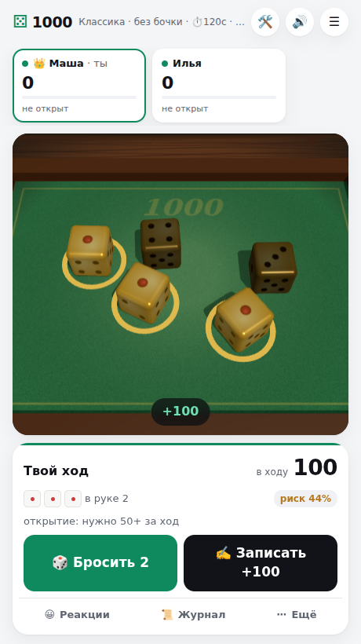
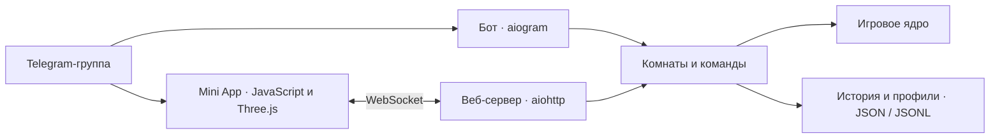

# «1000» — игра в кости для Telegram

[](https://github.com/sylozap/1000-costi/actions/workflows/tests.yml)

Многопользовательская игра в кости для компании до восьми человек. Бот создаёт комнату в групповом чате, а партия идёт в Telegram Mini App с 3D-столом и общим счётом. Игроки по очереди бросают кубики и решают, записать набранные за ход очки или рискнуть ещё одним броском.

Игровой движок на сервере проверяет ходы и рассчитывает очки. Комнаты синхронизируют состояние между игроками через WebSocket, а клиент рисует бросок по результату сервера.

**Стек** · Python 3.11+, aiohttp, WebSocket, aiogram, JavaScript ES-модули, Three.js, pytest.



## Возможности

- Одиночный зачёт, команды по двое и боты-соперники для игры без компании.
- Настраиваемые правила и пресеты, карты стола, таймер хода и банк игровых фишек.
- Синхронное отображение бросков, реакции и журнал событий партии.
- Профили игроков, история партий, достижения, рекорды чата и графики счёта.

## Архитектура



При каждом действии сервер проверяет очередь хода и доступность операции. После действия он рассылает игрокам новый снимок партии. Тот же снимок получает клиент при переподключении.

Активные комнаты живут в памяти процесса. История завершённых партий, статистика, профили и пресеты сохраняются в `data/`.

| Модуль | Ответственность |
| --- | --- |
| [`run.py`](run.py) | Запуск веб-сервера и Telegram-бота |
| [`game/engine/`](game/engine/) | Ходы, состояние игроков и команд, подсчёт вероятностей, снимок партии |
| [`game/rooms/`](game/rooms/) | Лобби, обработка команд, таймеры, рассылка и управление комнатами |
| [`game/history/`](game/history/) | Хранение завершённых партий, аналитика и управление архивом |
| [`game/bot/`](game/bot/) и [`game/web/`](game/web/) | Команды и уведомления Telegram, HTTP-маршруты и WebSocket-сессии |
| [`webapp/`](webapp/) | Подключение и очередь серверных состояний, экраны Mini App, админ-панель и 3D-стол |

## Быстрый запуск без Telegram

На Linux или macOS запустите сервер из корня проекта.

```bash
python3 -m venv .venv
.venv/bin/python -m pip install -r requirements.txt
BOT_TOKEN= DEV_MODE=1 HOST=127.0.0.1 .venv/bin/python run.py
```

Создайте комнату в другом терминале.

```bash
curl 'http://127.0.0.1:8080/dev/new?uid=1&name=Masha'
```

Из ответа `{"room": "..."}` подставьте идентификатор комнаты вместо `ROOM_ID`. Откройте два адреса в отдельных вкладках.

- `http://127.0.0.1:8080/?room=ROOM_ID&dev_uid=1&dev_name=Masha`
- `http://127.0.0.1:8080/?room=ROOM_ID&dev_uid=2&dev_name=Ilya`

В первой вкладке нажмите **«Начать игру»**. Оба игрока бросают кубики за очерёдность, затем ходят по очереди. Подробнее о подсчёте очков и вариантах игры — в [правилах](docs/rules.md).

## Тесты

```bash
.venv/bin/python -m pip install -r requirements.txt pytest
.venv/bin/python -m pytest -q
```

Тесты покрывают правила, команды комнат, командную игру, проверку подписи Telegram, уведомления, статистику и историю. [GitHub Actions](.github/workflows/tests.yml) запускает pytest на Python 3.11 и 3.12 при пушах и открытии или обновлении pull request.

## Запуск в Telegram

1. Создайте бота через [BotFather](https://t.me/BotFather) командой `/newbot`. Скопируйте [`.env.example`](.env.example) в `.env` и заполните данные своего бота и сервера по примеру.

   ```dotenv
   BOT_TOKEN=ваш_токен
   PUBLIC_URL=https://dice.example.com
   TUNNEL=none
   ENTRY_MODE=direct
   HOST=127.0.0.1
   PORT=8080
   DEV_MODE=0
   ADMIN_IDS=
   ```

2. Направьте публичный HTTPS-адрес на локальный сервер, включая WebSocket по пути `/ws`. Для nginx есть [пример настроек](deploy/nginx-locations.conf). В BotFather откройте настройки бота и укажите публичный адрес в **Configure Mini App**.
3. Запустите `./run.sh`, добавьте бота в групповой чат и отправьте `/newgame`. Бот пришлёт кнопку **«Играть»**. Команда `/stats` показывает статистику чата, а `/records` — рекорды и последние партии.

`ADMIN_IDS` можно заполнить идентификаторами пользователей Telegram через запятую для доступа к админ-панели. Для локального туннеля доступны настройки ngrok и cloudflared в [`run.sh`](run.sh). Для постоянного запуска на сервере в [`deploy/`](deploy/) есть конфигурация systemd.
